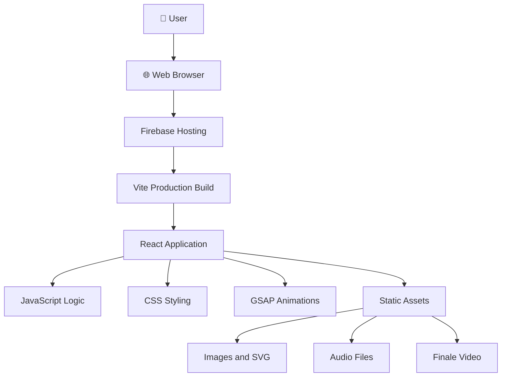

#  LUMORA — A Golden Diwali Experience

<p align="center">
  <strong>Celebrate the Festival of Lights through an immersive digital experience.</strong>
</p>

<p align="center">
  🌐 <a href="https://lumora-54307.web.app/">Live Website</a> · 💻 <a href="https://github.com/imtiazsarkar863/LUMORA">GitHub Repository</a>
</p>

---

##  About the Project

**LUMORA** is an interactive Diwali celebration website designed to bring the warmth, beauty, and magic of the Festival of Lights to the digital world.

Instead of a traditional static festive webpage, LUMORA creates an immersive experience through elegant golden animations, interactive elements, festive music, and cinematic visual effects.

Every interaction is designed to capture the spirit of Diwali — light, celebration, joy, and togetherness.

##  Key Features

- **Immersive Animations:** Smooth transitions and cinematic visual effects powered by GSAP.
- **Golden Screen Effect:** A dramatic golden visual experience during the celebration.
- **Interactive Diya:** An interactive festive element inspired by traditional Indian lamps.
- **Festive Greetings:** Beautifully presented Diwali wishes.
- **Ambient Music:** Background festive audio for a more immersive experience.
- **Firecracker Effects:** Animated festive effects with sound.
- **Cinematic Finale:** A video-based closing experience.
- **Responsive Design:** Adapted for desktop and mobile screens.

##  Tech Stack

| Technology | Purpose |
|---|---|
| React.js | Component-based UI |
| Vite | Development server and build tool |
| JavaScript | Application logic and interactions |
| CSS3 | Styling, layouts and visual effects |
| GSAP | Animations and transitions |
| Firebase Hosting | Website deployment |

##  System Architecture

LUMORA follows a lightweight client-side architecture. The React application is built into static production assets and hosted using Firebase Hosting.



### Architecture Overview

1. **User Interface:** Visitors access LUMORA through a web browser.
2. **Hosting Layer:** Firebase Hosting serves the production website.
3. **Frontend Layer:** React manages the application's interface and interactions.
4. **Animation Layer:** GSAP powers visual transitions and animated experiences.
5. **Asset Layer:** Images, SVG graphics, audio, and video files provide the visual and multimedia experience.

##  Project Structure

```text
LUMORA/
│
├── public/
│   ├── background.jpg
│   ├── diwali-finale.mp4
│   ├── diwali_theme.mp3
│   ├── firecracker-whistle.mp3
│   ├── diya.svg
│   ├── logo.png
│   ├── mandala.png
│   └── mandala-floor.png
│
├── src/
│   ├── assets/
│   ├── App.jsx
│   ├── App.css
│   └── main.jsx
│
├── index.html
├── package.json
├── vite.config.js
├── firebase.json
└── README.md
```

*Note: The structure above highlights the main project files. Your actual source directory may contain additional components and assets.*

##  Getting Started

Follow these steps to run LUMORA locally.

### Prerequisites

- Node.js
- npm
- Git

### 1. Clone the repository

```bash
git clone https://github.com/imtiazsarkar863/LUMORA.git
```

### 2. Navigate to the project

```bash
cd LUMORA
```

### 3. Install dependencies

```bash
npm install
```

### 4. Start the development server

```bash
npm run dev
```

Open the local URL displayed in your terminal.

## 📦 Production Build

To generate an optimized production build:

```bash
npm run build
```

The production-ready files will be generated inside the `dist/` directory.

## ☁️ Deployment

LUMORA is deployed using **Firebase Hosting**.

To deploy an updated version:

```bash
npm run build
firebase deploy --only hosting
```

**Live Website:** https://lumora-54307.web.app/

## 🎯 Project Vision

LUMORA explores how modern frontend technologies can transform a traditional cultural celebration into an interactive digital experience.

The goal is simple: bring the magic of Diwali beyond physical lights and celebrations, and make it accessible through a browser.

## 👨‍💻 Developer

**Imtiaz Sarkar**

- GitHub: [@imtiazsarkar863](https://github.com/imtiazsarkar863)
- Project: [LUMORA](https://lumora-54307.web.app/)

---

<p align="center">
  <strong>✨ LUMORA — Let the Light Speak. ✨</strong>
</p>